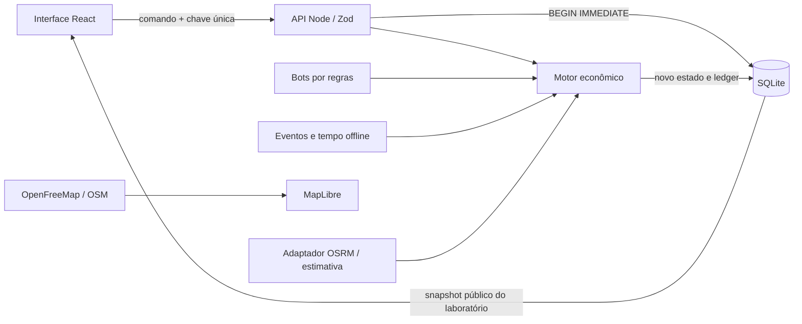

# Arquitetura · Laboratório 0.1

## Fluxo de autoridade

O frontend apresenta e solicita operações. O servidor escolhe o estado vigente, aplica tempo pendente e verifica comandos. A confirmação financeira só aparece quando o banco confirma a transação.

## Responsabilidades

`packages/simulation` define modelos, receitas, unidades, cotação, comandos e processamento temporal. Recebe `now` por parâmetro para permitir testes determinísticos de tempo. Não depende de componentes React, banco ou chamadas HTTP.

`apps/server` valida payloads com Zod, permite somente os dois atores locais, controla idempotência e transações e persiste o estado. A identidade por header é exclusivamente uma ferramenta de desenvolvimento, não autenticação.

`apps/web` mantém navegação, câmera, seleção, confirmação e feedback. Consulta o servidor a cada três segundos. Regras de cotação são compartilhadas para a prévia, mas são recalculadas no servidor antes de aceitar o pagamento.

`packages/world` contém referências geográficas e dados importados. Coordenadas são `[longitude, latitude]`; a interface pode exibir latitude primeiro para leitura humana.

## Persistência e atomicidade

O SQLite usa WAL, `BEGIN IMMEDIATE` e uma linha com snapshot JSON do mundo. Uma tabela de recibos registra chave, ator e comando. Uma chave repetida para o mesmo pedido não executa novamente; uso com outro pedido é rejeitado. Uma exceção provoca rollback integral.

Esse desenho evita múltiplos donos e cobranças duplicadas em uma instância local e simplifica o primeiro teste. Não é uma arquitetura distribuída. O volume de ledger e serialização crescerá com o mundo; a fase 02 substitui o snapshot por tabelas relacionais com restrições, índices e autorização.

## Valores, estoque e contabilidade

- Dinheiro circula em **centavos inteiros**. Transferências debitam uma conta e creditam outra; não há emissão por compra, frete, produção ou consumo.
- Estoque é contado na unidade do produto. Cada unidade possui massa e volume.
- Compra com transporte remove a mercadoria da origem e cria inventário em trânsito. A entrega transfere a carga ao destino uma única vez.
- Custo médio do recebimento inclui mercadoria e frete. Produção reserva entradas e capitaliza materiais/serviços no lote de saída.
- Venda reconhece receita e custo da mercadoria. Custos operacionais recorrentes são reconhecidos por rodada.
- O balanço agrega caixa, propriedades, veículos, estoque disponível, produção e cargas em trânsito. Não há dívida nem depreciação nesta versão.
- Os preços de aquisição e custos iniciais são valores do cenário; não representam avaliação contábil ou imobiliária real.

O fornecedor e a transportadora recebem no fechamento da compra. Escrow, cancelamento, perdas, seguro e liquidação por entrega precisam de novos estados e contratos antes de uso público.

## Tempo e reservas

A simulação usa 120× no laboratório. Prazos e rodadas compartilham essa conversão. O motor ordena entregas, produção e ticks econômicos por vencimento. Materiais e capacidade são reservados antes de iniciar atividades; os ciclos de um estabelecimento são sequenciais.

O servidor processa eventos a cada dois segundos e antes de leituras/comandos. Após um desligamento, o primeiro acesso recupera os eventos vencidos. Cada chamada limita o trabalho a 5.000 eventos; mundos muito atrasados podem exigir mais de uma rodada de processamento. Filas e limites de recuperação serão medidos antes de escalar.

As vendas possuem estoque, concorrência por preço e orçamento agregado finito. A receita não aparece sem débito dos consumidores. Bots extrativos e industriais usam os mesmos comandos de domínio; seus comportamentos completos de compra, expansão e encerramento estão planejados.

## Geografia e rotas

MapLibre usa Bright/OpenFreeMap com cores adaptadas. Não usa screenshot como mapa. Lotes desenhados são áreas virtuais retangulares de referência, não cadastros imobiliários oficiais. A seleção tem contorno independente da atividade.

O adaptador consulta OSRM somente para coordenadas de propriedades conhecidas. Armazena rotas válidas e identifica a alternativa geográfica quando não há serviço. A cotação inclui distância, capacidade, deslocamento do veículo até a origem e margem parametrizada. Isso não comprova viabilidade legal de caminhões na rota; Valhalla truck e dados de restrições são a evolução prevista.

## Antes do acesso público

A fase 02 precisa entregar autenticação, autorização por recurso e respostas com dados permitidos, além de migração relacional, controle concorrente entre processos e recuperação de pedidos. A alpha exigirá backup restaurado, limites por cliente, observabilidade, testes de falhas e medição de carga. Esses itens são requisitos do produto, não funcionalidades que a interface atual comprova.
