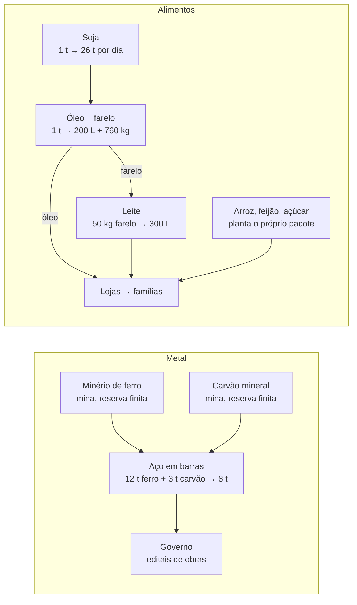

# Economia hoje

Resumo em linguagem simples, 27/10/2026. Ponto de entrada para três relatórios técnicos gerados pelo código. Para atualizar os três de uma vez: `npm run economy:report`.

| Pergunta                                                                 | Relatório                                                                 |
| ------------------------------------------------------------------------ | ------------------------------------------------------------------------- |
| Quais produtos e receitas existem, quem fornece, quanto rende uma linha? | [RESOURCE-CATALOG](RESOURCE-CATALOG.md)                                   |
| Quais contas do motor ou dos bots estão erradas?                         | [MATHEMATICS-AUDIT](MATHEMATICS-AUDIT.md)                                 |
| De onde vem cada coisa e que fluxos estão incompletos (36 itens)?        | [MECHANICS-REPORT](MECHANICS-REPORT.md)                                   |
| Como admitir um produto ou receita novo?                                 | [RESOURCE-STANDARD](RESOURCE-STANDARD.md) e [ficha](RESOURCE-TEMPLATE.md) |

## As duas cadeias

## Quanto rende uma linha de produção

Uma linha em SP, equipe mínima, preços de abertura, vendendo tudo o que produz, **sem** frete, imóvel ou equipamento. É o melhor caso possível; um número negativo aqui significa prejuízo por construção.

| Receita          | Resultado por dia | Leitura                                  |
| ---------------- | ----------------: | ---------------------------------------- |
| Aço              |       +R$ 120.324 | Muito lucrativo, mas só o governo compra |
| Soja             |        +R$ 47.923 | Muito lucrativo                          |
| Carvão           |         +R$ 7.719 | Ok                                       |
| Óleo de soja     |         +R$ 4.727 | Ok, mas gera farelo sem comprador        |
| Leite            |           −R$ 534 | Prejuízo por construção                  |
| Feijão           |           −R$ 774 | Prejuízo por construção                  |
| Açúcar           |           −R$ 911 | Prejuízo por construção                  |
| Minério de ferro |           −R$ 952 | Prejuízo por construção                  |
| Arroz            |           −R$ 976 | Prejuízo por construção                  |

A diferença entre o melhor (aço) e o pior (arroz) é de mais de R$ 120 mil por dia. Isso empurra todo mundo, bots inclusive, para as mesmas duas atividades e explica parte da concentração de mercado.

## Os furos

1. **Aço sem cliente privado.** O governo é o único comprador. Se a arrecadação cair, a cadeia para.
2. **Farelo encalhado.** Em 90 dias de simulação foram produzidos 182.400 kg de farelo e consumidos só 550 kg (0,3%). O leite não absorve e não existe outro comprador.
3. **Cinco receitas com prejuízo por construção** (tabela acima). Mais linhas só aumentam a perda.
4. **Semente inexistente.** Planta-se o pacote de mercado; as primeiras unidades aparecem na abertura do mundo. Leite não tem rebanho.
5. **Massa que some.** No aço, 7 das 15 t de entrada desaparecem sem virar resíduo ou coproduto.

## Contas erradas que enganam os bots

| Código | O que acontece                                                                                                                                                    |
| ------ | ----------------------------------------------------------------------------------------------------------------------------------------------------------------- |
| M02    | O bot calcula que a fazenda de leite rende +R$ 4.509/dia; respeitando o tempo de produção, rende −R$ 627/dia. Ele gasta caixa para reabrir uma operação inviável. |
| M03    | A previsão de uma usina de aço anuncia 48 lotes/dia; a automação executa 30.                                                                                      |
| M04    | Duas lojas iguais na mesma cidade podem vender zero cada uma, porque frações da demanda são arredondadas para baixo por loja.                                     |
| M05    | A loja atende produtos na ordem da lista: o óleo consome toda a capacidade e o leite fica sem venda.                                                              |
| M07    | Cada fábrica de óleo mira três dias da demanda **total** do mercado; com quatro fábricas, o estoque-alvo quadruplica.                                             |

## O que vem a seguir

Etapa B do [roteiro](../../.planning/ROADMAP.md): redesenhar as cadeias no papel com o Pedro, corrigir M02–M05 e M07, ajustar receitas num mundo novo e provar no `/lab` com 90 dias de bots.
