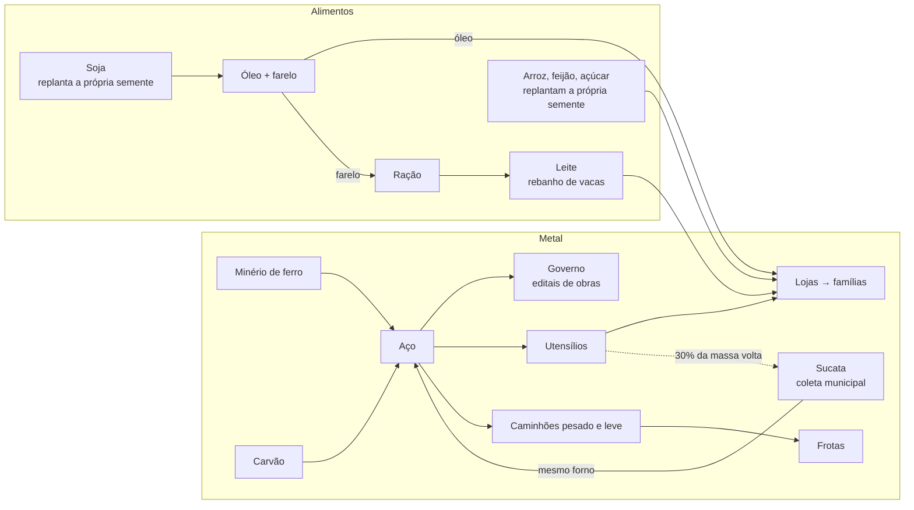

# Economia hoje

Resumo em linguagem simples, 30/10/2026. Existe **uma única economia** no motor (D-042, spec 001): a do catálogo da etapa B. Os números de projeto estão em [ECONOMIA-ALVO](ECONOMIA-ALVO.md); o que os bots fazem de verdade está na [PROVA](PROVA.md) (escalas 1 e 20). Para atualizar os relatórios técnicos: `npm run economy:report`.

| Pergunta                                                                 | Relatório                                                                 |
| ------------------------------------------------------------------------ | ------------------------------------------------------------------------- |
| Quais produtos e receitas existem, quem fornece, quanto rende uma linha? | [RESOURCE-CATALOG](RESOURCE-CATALOG.md)                                   |
| De onde vem cada coisa e que fluxos estão incompletos?                   | [MECHANICS-REPORT](MECHANICS-REPORT.md)                                   |
| Como admitir um produto ou receita novo?                                 | [RESOURCE-STANDARD](RESOURCE-STANDARD.md) e [ficha](RESOURCE-TEMPLATE.md) |

## As cadeias

20 itens e 14 receitas, em 59 municípios.

## Os furos que continuam

Medidos na escala 20 pela régua da spec 003 ([PROVA](PROVA.md), 03/11/2026, spec 006): a calculadora fecha em todas as receitas (preços na faixa real, equipamento que se paga em ~42 dias); bots abrem com 100% das linhas e lojas-bot cobrem 70% da procura. Resultado: lojas atendem 56% da procura (era 45%; alvo ≥ 55%), aço ao governo ~200 de 320 t/dia (era 180; alvo 256), caminhões pesados no ritmo de referência. Continua fora: aço ao governo, caminhão leve (lucro abaixo do projeto), aço em alto-forno e feijão (lucro acima), sucata concentrada (HHI > 2.500), 1 mina de carvão excedente suspensa por semente. Tetos de preço dos bots (1,5×) e bônus do governo (1,25) ficaram: apertá-los hoje derruba a procura atendida (medido na 006).

## Contas dos bots corrigidas

As contas que enganavam os bots continuam provadas em `tests/formula-fixes.test.ts`, sobre as receitas atuais.

| Código | O que garante                                                                                 |
| ------ | --------------------------------------------------------------------------------------------- |
| M02    | O bot só reabre um negócio contando os ciclos que a linha consegue fazer por dia.             |
| M03    | Previsão, reposição e procura industrial usam a mesma conta da produção automática.           |
| M04    | Frações da procura ficam guardadas: duas lojas iguais vendem quase o mesmo que uma.           |
| M05    | Loja sem capacidade para tudo reparte as vendas pela procura de cada produto, não pela ordem. |
| M07    | A meta de estoque de uma fábrica é a procura do mundo dividida entre as fábricas ativas.      |
