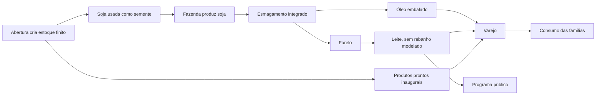

# Relatório das mecânicas, origem dos recursos e fluxos incompletos

**Sementes não existem como item próprio.** As primeiras unidades agrícolas são inseridas na abertura. Óleo e farelo são saídas conjuntas da soja. Leite consome farelo, sem rebanho modelado. Produção e venda funcionam, mas isso não completa as origens físicas nem demonstra equilíbrio.

Fonte econômica: **configuração/snapshot salvos, somente leitura**. Estado observado: **27/10/2026, 06:36:34, America/Sao_Paulo**; revisão **7.509**; season `migrated-1792998233713`. Estoques inaugurais abaixo são da abertura do código atual e não uma reconstrução histórica do banco.

Preços em reais. Separar referência de abertura, anúncio, custo médio do estoque e custo de fabricação. Valores são parâmetros de jogo, sem verificação de cotações/agronomia reais nesta entrega. Nenhuma regra, saldo ou estoque da season foi alterado.

Conteúdo: sementes; óleo/farelo/leite; catálogo/estoque inicial; receitas/custos; tempo/CAPEX; trabalho/utilidades; demanda/varejo; abastecimento; logística; governo; finanças; agentes/snapshot; fluxos incompletos; fontes e reprodução.

## 1. Sementes: de onde vêm e quanto valem

Os próprios IDs de soja, arroz, feijão e açúcar são usados como entrada agrícola. Não existe preço específico de semente nem produtor desse insumo. O açúcar embalado inicia uma cadeia de cana por convenção fictícia; não representa propagação real de cana.

| Entrada usada como semente | Por ciclo | Referência da entrada | Saída bruta | Retenção para repetir | Excedente líquido |
| -------------------------- | --------- | --------------------- | ----------- | --------------------- | ----------------- |
| Soja em grão               | 1 t       | R$ 2.500,00           | 26 t        | 1 t                   | 25 t              |
| Arroz 5 kg                 | 1 un      | R$ 23,45              | 160 un      | 1 un                  | 159 un            |
| Feijão 1 kg                | 1 un      | R$ 8,70               | 400 un      | 1 un                  | 399 un            |
| Açúcar 5 kg                | 1 un      | R$ 17,45              | 180 un      | 1 un                  | 179 un            |

**Primeira unidade:** atores antigos recebem estoque diretamente em `seed.ts`, sem compra/fabricação anterior. Novos rivais recebem capital finito e pagam ao tesouro pelo estoque criado em `competition.ts`; não compram de um produtor anterior. Depois, precisam produzir ou comprar estoque existente. Nenhum tick repõe sementes gratuitamente.

| Produto      | Fazenda / ID                   | Praça                 | Quantidade inaugural | Custo contábil/unidade | Livre para venda | Origem                            |
| ------------ | ------------------------------ | --------------------- | -------------------- | ---------------------- | ---------------- | --------------------------------- |
| Soja em grão | Fazenda São José / e-farm      | Sorocaba              | 80 t                 | R$ 1.875,00            | 80               | Demonstrativo sem compra anterior |
| Soja em grão | AgroVale Alimentos / e-agro    | Santa Bárbara d’Oeste | 600 t                | R$ 1.875,00            | 599              | Demonstrativo sem compra anterior |
| Soja em grão | Veredas Agro / e-rival-5       | Sorocaba              | 10 t                 | R$ 2.500,00            | 9                | Criado e pago ao tesouro          |
| Arroz 5 kg   | Aliança Agro / e-rival-7       | Itabira               | 2 un                 | R$ 23,45               | 1                | Criado e pago ao tesouro          |
| Feijão 1 kg  | Boa Vista Agro / e-rival-8     | Belo Horizonte        | 2 un                 | R$ 8,70                | 1                | Criado e pago ao tesouro          |
| Açúcar 5 kg  | Integra Agro / e-rival-9       | São Paulo             | 2 un                 | R$ 17,45               | 1                | Criado e pago ao tesouro          |
| Soja em grão | União Agro / e-rival-15        | São Paulo             | 10 t                 | R$ 2.500,00            | 9                | Criado e pago ao tesouro          |
| Arroz 5 kg   | Terra Nova Agro / e-rival-17   | Campinas              | 2 un                 | R$ 23,45               | 1                | Criado e pago ao tesouro          |
| Feijão 1 kg  | Progresso Agro / e-rival-18    | Piracicaba            | 2 un                 | R$ 8,70                | 1                | Criado e pago ao tesouro          |
| Açúcar 5 kg  | Cruzeiro Agro / e-rival-19     | Americana             | 2 un                 | R$ 17,45               | 1                | Criado e pago ao tesouro          |
| Soja em grão | Rota Norte Agro / e-rival-25   | Americana             | 10 t                 | R$ 2.500,00            | 9                | Criado e pago ao tesouro          |
| Arroz 5 kg   | Sol Nascente Agro / e-rival-27 | Sorocaba              | 2 un                 | R$ 23,45               | 1                | Criado e pago ao tesouro          |
| Feijão 1 kg  | Ideal Agro / e-rival-28        | São José dos Campos   | 2 un                 | R$ 8,70                | 1                | Criado e pago ao tesouro          |
| Açúcar 5 kg  | Fortaleza Agro / e-rival-29    | Itabira               | 2 un                 | R$ 17,45               | 1                | Criado e pago ao tesouro          |

Com automação agrícola, a entrada × ciclos configurados fica protegida da venda. Desligada, a proteção deixa de existir; vender a última entrada pode paralisar a cadeia. Compra de outro fornecedor paga preço anunciado + frete. O custo médio da semente retida muda conforme os lotes recebidos/produzidos.

`--seed` dos experimentos é a semente de calendário/estratégia da simulação, não uma mercadoria. Fontes: `seed.ts`, `competition.ts: portfolio`, `operations.ts: availableStock`, `engine.ts: produce`.

## 2. Óleo, farelo e leite: origem e valor



**Óleo/farelo:** 1 t Soja em grão → 200 un Óleo de soja 1 L + 760 kg Farelo de soja, em 1 hora virtual. Soja de referência: R$ 2.500,00; processamento: R$ 160,00; energia/SP: R$ 138,00; água/SP: R$ 10,00. Custo variável do lote: **R$ 2.808,00**, antes de fixos/frete/CAPEX.

As saídas são obrigatoriamente conjuntas. Farelo não tem receita própria nem consumidor familiar. Seu único uso produtivo atual é leite. Esmagamento, refino e envase são agregados; embalagens não são compradas como item.

**Leite:** 50 kg Farelo de soja → 300 un Leite 1 L, em 24 horas virtuais. Farelo de referência: R$ 115,00; processamento: R$ 700,00; energia/SP: R$ 82,80; água/SP: R$ 80,00. Custo variável: **R$ 977,80**, ou **R$ 3,2593 por unidade**, antes de fixos/frete/CAPEX.

**Faltam no leite:** compra/criação de vacas, tamanho/reprodução/mortalidade do rebanho, pastagem, alimentação complementar, ordenha separada, refrigeração, embalagem e validade. Há fazenda, equipe, água/energia, tempo e farelo; o resto é abstração.

O motor aloca o custo do esmagamento pelo valor interno das saídas na contratação; sem oferta usa abertura (×0,82 para unidade `un`). A soma alocada conserva o custo. Não atribuir o custo integral simultaneamente ao óleo e ao farelo.

| Saída            | Quantidade | Custo alocado pelo motor | Custo alocado/unidade |
| ---------------- | ---------- | ------------------------ | --------------------- |
| Óleo de soja 1 L | 200 un     | R$ 1.165,30              | R$ 5,8265             |
| Farelo de soja   | 760 kg     | R$ 1.642,70              | R$ 2,1614             |

Demonstração em cópia da abertura, com soja à referência analisada, utilidades/SP e anúncios da abertura. Não é custo atual de todos os estoques nem venda garantida.

**Oferta conjunta:** 1 unidade de oil gera 3,8 unidades de soymeal, equivalentes a 22,8 unidades de milk. Consumo familiar relativo: 10. Excesso teórico do coproduto: **56,1404%** na hipótese somente familiar; programas públicos, lojas ativas, estoques e outras origens mudam o realizado.

O estoque inicial de óleo, farelo e leite também é criado na abertura, conforme a tabela seguinte; existir no primeiro instante não comprova fabricação.

## 3. Itens, unidades, preços e estoque criado na abertura

| Item / ID                | Unidade | kg/unidade | m³/unidade | Referência da season | Faixa de calibração       |
| ------------------------ | ------- | ---------- | ---------- | -------------------- | ------------------------- |
| Minério de ferro / iron  | t       | 1.000      | 0,45       | R$ 500,00            | R$ 350,00 a R$ 650,00     |
| Carvão mineral / coal    | t       | 1.000      | 1,3        | R$ 1.800,00          | R$ 1.300,00 a R$ 2.400,00 |
| Aço em barras / steel    | t       | 1.000      | 0,15       | R$ 4.800,00          | R$ 3.800,00 a R$ 6.200,00 |
| Soja em grão / soy       | t       | 1.000      | 1,4        | R$ 2.500,00          | R$ 2.100,00 a R$ 2.700,00 |
| Farelo de soja / soymeal | kg      | 1          | 0,0017     | R$ 2,30              | R$ 1,70 a R$ 2,80         |
| Óleo de soja 1 L / oil   | un      | 0,92       | 0,0013     | R$ 8,49              | R$ 6,50 a R$ 10,50        |
| Arroz 5 kg / rice        | un      | 5          | 0,007      | R$ 23,45             | R$ 19,00 a R$ 30,00       |
| Feijão 1 kg / beans      | un      | 1          | 0,0015     | R$ 8,70              | R$ 6,50 a R$ 12,00        |
| Açúcar 5 kg / sugar      | un      | 5          | 0,006      | R$ 17,45             | R$ 14,00 a R$ 23,00       |
| Leite 1 L / milk         | un      | 1,03       | 0,0012     | R$ 5,49              | R$ 4,00 a R$ 7,50         |

Óleo/leite: unidade de 1 litro; arroz/açúcar: pacote de 5 kg; feijão: pacote de 1 kg. Faixas não são limites de mercado e não foram verificadas como cotações nesta entrega.

| Item             | Criado para atores antigos | Criado/pago pelos novos rivais | Total inaugural | Valor pago ao tesouro pelos rivais |
| ---------------- | -------------------------- | ------------------------------ | --------------- | ---------------------------------- |
| Minério de ferro | 2.490                      | 243                            | 2.733 t         | R$ 121.500,00                      |
| Carvão mineral   | 218                        | 117                            | 335 t           | R$ 210.600,00                      |
| Aço em barras    | 24                         | 96                             | 120 t           | R$ 460.800,00                      |
| Soja em grão     | 724                        | 54                             | 778 t           | R$ 135.000,00                      |
| Farelo de soja   | 0                          | 3.000                          | 3.000 kg        | R$ 6.900,00                        |
| Óleo de soja 1 L | 16.160                     | 3.840                          | 20.000 un       | R$ 32.601,60                       |
| Arroz 5 kg       | 3.292                      | 96                             | 3.388 un        | R$ 2.251,20                        |
| Feijão 1 kg      | 2.150                      | 126                            | 2.276 un        | R$ 1.096,20                        |
| Açúcar 5 kg      | 1.920                      | 66                             | 1.986 un        | R$ 1.151,70                        |
| Leite 1 L        | 1.845                      | 840                            | 2.685 un        | R$ 4.611,60                        |

Custo contábil demonstrativo antigo = 67% da referência nas lojas e 75% nas demais unidades, arredondado. Rivais novos pagam 100% da referência do estoque inaugural. São escolhas da abertura, não cálculo de fabricação. Patrimônio antigo também é atribuído diretamente.

## 4. Receitas, produtividade e custos comparáveis

| Receita         | Entrada → saída bruta                                              | Horas virtuais/ciclo | Pessoas / m² por linha | kWh / m³ água | Processamento | Energia + água/SP |
| --------------- | ------------------------------------------------------------------ | -------------------- | ---------------------- | ------------- | ------------- | ----------------- |
| steel-bars      | 12 t Minério de ferro + 3 t Carvão mineral → 8 t Aço em barras     | 1                    | 18 / 6.000             | 4.400 / 24    | R$ 12.000,00  | R$ 4.528,00       |
| soy-oil         | 1 t Soja em grão → 200 un Óleo de soja 1 L + 760 kg Farelo de soja | 1                    | 8 / 1.800              | 150 / 0,5     | R$ 160,00     | R$ 148,00         |
| soy-harvest     | 1 t Soja em grão → 26 t Soja em grão                               | 24                   | 6 / 200.000            | 80 / 25       | R$ 12.800,00  | R$ 573,60         |
| iron-extraction | Sem item de estoque → 1 t Minério de ferro                         | 0,1                  | 12 / 90.000            | 30 / 0,8      | R$ 145,00     | R$ 43,60          |
| coal-extraction | Sem item de estoque → 1 t Carvão mineral                           | 0,2                  | 12 / 90.000            | 50 / 1        | R$ 700,00     | R$ 66,00          |
| rice-harvest    | 1 un Arroz 5 kg → 160 un Arroz 5 kg                                | 72                   | 6 / 200.000            | 160 / 50      | R$ 1.900,00   | R$ 1.147,20       |
| beans-harvest   | 1 un Feijão 1 kg → 400 un Feijão 1 kg                              | 72                   | 6 / 200.000            | 90 / 25       | R$ 1.600,00   | R$ 582,80         |
| sugar-harvest   | 1 un Açúcar 5 kg → 180 un Açúcar 5 kg                              | 72                   | 6 / 200.000            | 160 / 30      | R$ 1.500,00   | R$ 747,20         |
| milk-production | 50 kg Farelo de soja → 300 un Leite 1 L                            | 24                   | 6 / 20.000             | 90 / 4        | R$ 700,00     | R$ 162,80         |

Entradas/reserva são debitadas antes do início. Saída só entra ao terminar. Linhas = menor limite de equipe, área e equipamento. Duração do lote = duração por ciclo × teto(ciclos/linhas). A unidade mantém fila serial. Falta de insumo, água, energia, equipe, espaço ou caixa impede produzir.

**Hipótese comparável:** uma linha/SP, equipe mínima, índice salarial 1, lotes automáticos de um ciclo, materiais/saídas à referência, venda integral. Sem frete, investimento, financiamento, limite de demanda/caixa ou ociosidade. Semente retida é valorada dos dois lados e não contabilizada como venda real.

| Receita         | Material/ciclo | Variável/ciclo | Valor bruto/ciclo | Contribuição/ciclo | Fixos/dia   | Ciclos/dia | Resultado/dia nesta hipótese | Utilização de equilíbrio |
| --------------- | -------------- | -------------- | ----------------- | ------------------ | ----------- | ---------- | ---------------------------- | ------------------------ |
| steel-bars      | R$ 11.400,00   | R$ 27.928,00   | R$ 38.400,00      | R$ 10.472,00       | R$ 5.339,40 | 12         | R$ 120.324,60                | 4,2489%                  |
| soy-oil         | R$ 2.500,00    | R$ 2.808,00    | R$ 3.446,00       | R$ 638,00          | R$ 2.928,60 | 12         | R$ 4.727,40                  | 38,2524%                 |
| soy-harvest     | R$ 2.500,00    | R$ 15.873,60   | R$ 65.000,00      | R$ 49.126,40       | R$ 1.203,00 | 1          | R$ 47.923,40                 | 2,4488%                  |
| iron-extraction | R$ 0,00        | R$ 188,60      | R$ 500,00         | R$ 311,40          | R$ 4.688,64 | 12         | -R$ 951,84                   | 125,4721%                |
| coal-extraction | R$ 0,00        | R$ 766,00      | R$ 1.800,00       | R$ 1.034,00        | R$ 4.688,64 | 12         | R$ 7.719,36                  | 37,7872%                 |
| rice-harvest    | R$ 23,45       | R$ 3.070,65    | R$ 3.752,00       | R$ 681,35          | R$ 1.203,00 | 0,3333     | -R$ 975,88                   | 529,6837%                |
| beans-harvest   | R$ 8,70        | R$ 2.191,50    | R$ 3.480,00       | R$ 1.288,50        | R$ 1.203,00 | 0,3333     | -R$ 773,50                   | 280,0931%                |
| sugar-harvest   | R$ 17,45       | R$ 2.264,65    | R$ 3.141,00       | R$ 876,35          | R$ 1.203,00 | 0,3333     | -R$ 910,88                   | 411,8218%                |
| milk-production | R$ 115,00      | R$ 977,80      | R$ 1.647,00       | R$ 669,20          | R$ 1.203,00 | 1          | -R$ 533,80                   | 179,7669%                |

Cadência automática = teto(duração do lote/intervalo econômico) × intervalo. Uma receita de uma hora, em lotes unitários, reinicia até 12 vezes/dia, não 24. Início/fim de safra alteram janelas curtas.

Uma linha de iron-extraction em lotes de **dez ciclos**: 120 ciclos/dia, resultado teórico **R$ 32.679,36/dia**, mesma hipótese de venda. Reserva de 15.000 duraria 125 dias. Prejuízo no lote unitário não significa prejuízo em qualquer escala.

Uma linha de coal-extraction em lotes de **dez ciclos**: 120 ciclos/dia, resultado teórico **R$ 119.391,36/dia**, mesma hipótese de venda. Reserva de 15.000 duraria 125 dias. Prejuízo no lote unitário não significa prejuízo em qualquer escala.

Custo médio = (valor anterior + custo recebido/produzido)/quantidade total. Frete é capitalizado no destino. Fixos não são automaticamente capitalizados nos jobs; são despesa da estrutura. Margem sobre venda m exige preço = custo completo/(1−m); custo × (1+m) é markup.

| Receita         | Entrada kg | Saída kg | Origem externa agregada kg | Residual sem estoque kg | Limite                                                                                                                                                                       |
| --------------- | ---------- | -------- | -------------------------- | ----------------------- | ---------------------------------------------------------------------------------------------------------------------------------------------------------------------------- |
| steel-bars      | 15.000     | 8.000    | 0                          | 7.000                   | 15 t entram e 8 t saem. As 7 t restantes não têm estoque/destino: fronteira agregada a detalhar; não chamar de resíduo industrial medido.                                    |
| soy-oil         | 1.000      | 944      | 0                          | 56                      | 1 t gera 184 kg de óleo e 760 kg de farelo. Restam 56 kg não rastreados; embalagem não é insumo físico.                                                                      |
| soy-harvest     | 1.000      | 26.000   | 25.000                     | 0                       | 1 t de soja funciona como semente agregada e gera 26 t; 25 t representam crescimento externo implícito. Sem área ocupada por safra, fertilizantes ou calendário agronômico.  |
| iron-extraction | 0          | 1.000    | 1.000                      | 0                       | Uma unidade da reserva virtual vira 1 t. A reserva atual é genérica por mina, sem teor nem identificação do mineral.                                                         |
| coal-extraction | 0          | 1.000    | 1.000                      | 0                       | Uma unidade da reserva virtual vira 1 t. Minério e carvão compartilham o mecanismo de reserva; geologia/beneficiamento não são simulados.                                    |
| rice-harvest    | 5          | 800      | 795                        | 0                       | Um pacote de varejo representa a semente de partida. Cultivo, beneficiamento e embalagem são agregados; crescimento líquido de 795 kg.                                       |
| beans-harvest   | 1          | 400      | 399                        | 0                       | Um pacote de varejo representa a semente. Cultivo/embalagem agregados; crescimento líquido de 399 kg.                                                                        |
| sugar-harvest   | 5          | 900      | 895                        | 0                       | Açúcar embalado funciona como entrada de partida fictícia da cana integrada. Crescimento líquido de 895 kg; não representa propagação real de cana.                          |
| milk-production | 50         | 309      | 259                        | 0                       | 50 kg de farelo geram 309 kg de leite; 259 kg são diferença agregada de fronteira. Rebanho, outra alimentação, água incorporada e embalagens não são bens físicos modelados. |

Origem externa/residual declarados tornam a fronteira visível; não são bens adicionados ao motor nem comprovação físico-química.

## 5. Tempo, capital, imóveis e equipamentos

| Regra                               | Número / significado                                                                                  |
| ----------------------------------- | ----------------------------------------------------------------------------------------------------- |
| Relógio                             | 120×; 1 s real = 2 min virtuais; um dia virtual = 12 min reais                                        |
| Tick econômico                      | 60 s reais = 2 h virtuais; 12 ticks/dia                                                               |
| Versões salvas                      | world=2; operations=3; competition=1; design=2; config=2026-10-26                                     |
| Capital humano demonstrativo        | R$ 2.850.625,00 por conta; duas contas; patrimônio inicial já atribuído                               |
| Bots antigos                        | Oito contas com R$ 6.500.000,00 cada antes das ações                                                  |
| Consumidores antes dos novos rivais | R$ 50.000.000,00; dinheiro não é recriado por tick                                                    |
| Capital dos novos rivais            | 30 empresas; até R$ 1.000.000,00 cada; limitado a 60% do caixa institucional dividido entre faltantes |
| Imóvel inaugural dos rivais         | Mínimo de 35% do capital e R$ 420 mil, pagos ao tesouro; instalação/equipe legadas preservadas        |
| Reserva da mina                     | 12.000 ao adquirir imóvel novo; 15.000 por mina dos novos rivais; valores próprios nas minas antigas  |
| Frota inaugural                     | 55 veículos: 12 da primeira conta humana, 13 das transportadoras antigas, 30 dos novos rivais         |
| Starter                             | R$ 120 mil por conta humana; loja 60 m², seis empregados, 21 t/84 m³; sem estoque/frota próprios      |
| Low-demand                          | Participação consumidora × 0,25; 25% do potencial familiar baseline                                   |

| Categoria | Equipamento/linha | Armazenamento t/m² | Armazenamento m³/m² |
| --------- | ----------------- | ------------------ | ------------------- |
| retail    | R$ 35.000,00      | 0,35               | 1,4                 |
| industry  | R$ 350.000,00     | 0,15               | 0,4                 |
| farm      | R$ 120.000,00     | 0,01               | 0,02                |
| mine      | R$ 420.000,00     | 0,1                | 0,15                |
| warehouse | R$ 80.000,00      | 0,5                | 2                   |
| logistics | R$ 100.000,00     | 0,1                | 0,15                |

Aquisição nova paga somente imóvel, sem equipe/equipamento. Instalação aceita 1–100 linhas, dentro da área; atividade não produtora limita a uma linha. Instalação é imediata e capacidade = piso(área × fator), mínimo 1. Legado preserva equipamentos/capacidades anteriores. Não há obra ou fabricante de máquinas.

| Imóvel disponível na abertura | Categoria | Área m²   | Preço            |
| ----------------------------- | --------- | --------- | ---------------- |
| Área industrial Hortolândia   | industry  | 12.000    | R$ 2.400.000,00  |
| Ponto comercial Campinas      | retail    | 180       | R$ 630.000,00    |
| Área rural Monte Mor          | farm      | 3.200.000 | R$ 22.400.000,00 |
| Pátio logístico Indaiatuba    | logistics | 15.000    | R$ 3.750.000,00  |
| Concessão virtual Limeira     | mine      | 1.800.000 | R$ 720.000,00    |
| Galpão industrial Americana   | industry  | 12.000    | R$ 2.400.000,00  |

Calibração dos imóveis disponíveis: indústria até 12.000 m² a R$ 200/m²; loja até 180 m² a R$ 3.500/m²; logística até 15.000 m² a R$ 250/m²; fazenda R$ 7/m²; concessão mineira virtual R$ 720 mil. Não são ofertas imobiliárias reais.

## 6. Trabalho, utilidades, manutenção e qualidade

| Categoria | Salário-base/mês | Manutenção/mês | Equipe comparada | Folha/dia SP | Energia fixa/dia SP | Água fixa/dia SP | Fixos efetivos/dia |
| --------- | ---------------- | -------------- | ---------------- | ------------ | ------------------- | ---------------- | ------------------ |
| retail    | R$ 2.400,00      | R$ 900,00      | 12               | R$ 1.774,08  | R$ 55,20            | R$ 28,80         | R$ 1.888,08        |
| industry  | R$ 3.800,00      | R$ 30.000,00   | 18               | R$ 4.213,44  | R$ 82,80            | R$ 43,20         | R$ 5.339,40        |
| farm      | R$ 2.600,00      | R$ 6.000,00    | 6                | R$ 960,96    | R$ 27,60            | R$ 14,40         | R$ 1.203,00        |
| mine      | R$ 4.200,00      | R$ 45.000,00   | 12               | R$ 3.104,64  | R$ 55,20            | R$ 28,80         | R$ 4.688,64        |
| warehouse | R$ 2.800,00      | R$ 6.000,00    | 12               | R$ 2.069,76  | R$ 55,20            | R$ 28,80         | R$ 2.353,80        |
| logistics | R$ 3.200,00      | R$ 7.000,00    | 12               | R$ 2.365,44  | R$ 55,20            | R$ 28,80         | R$ 2.682,72        |

Salário = arredondar(máximo entre R$ 1.621,00 e salário-base × fator estadual × índice salarial). Folha diária = empregados × salário × 1,65 / 30. Índice começa em 1 e cresce semanalmente por min(0,02; 0,002 + folha paga/10¹¹ centavos): 0,2%–2%. Teto técnico: 1.000 empregados/unidade, sem pool de candidatos.

| UF  | Fator salarial |
| --- | -------------- |
| AC  | 0,85           |
| AL  | 0,84           |
| AP  | 0,9            |
| AM  | 0,92           |
| BA  | 0,9            |
| CE  | 0,88           |
| DF  | 1,2            |
| ES  | 1,03           |
| GO  | 0,99           |
| MA  | 0,83           |
| MT  | 1,05           |
| MS  | 1,01           |
| MG  | 0,98           |
| PA  | 0,91           |
| PB  | 0,84           |
| PR  | 1,03           |
| PE  | 0,89           |
| PI  | 0,82           |
| RJ  | 1,1            |
| RN  | 0,87           |
| RS  | 1,04           |
| RO  | 0,91           |
| RR  | 0,9            |
| SC  | 1,08           |
| SP  | 1,12           |
| SE  | 0,86           |
| TO  | 0,9            |

| UF tarifária | R$/kWh  | R$/m³ água+esgoto | kWh/empregado/dia | m³/empregado/dia |
| ------------ | ------- | ----------------- | ----------------- | ---------------- |
| SP           | R$ 0,92 | R$ 20,00          | 5                 | 0,12             |
| MG           | R$ 0,96 | R$ 18,00          | 5                 | 0,12             |
| PR           | R$ 0,88 | R$ 17,00          | 5                 | 0,12             |

UF sem tarifa usa SP. Produção paga utilidades adicionais da receita. Cada componente fixo é dividido/arredondado em 12 cobranças/dia; há diferenças de centavos. Pausa mantém fixos; suspensão zera equipe e mantém 10% da manutenção.

| Qualidade/educação           | Número / consequência                                                    |
| ---------------------------- | ------------------------------------------------------------------------ |
| Sem qualidade salva          | 70/100                                                                   |
| Qualidade do local           | 60 + soma dos códigos dos caracteres do ID módulo 26; faixa 60–85        |
| Qualidade produtiva          | 80% média das entradas + 20% local + 3 × formação; arredondada, teto 100 |
| Sem entrada                  | Base é a qualidade do local; sem teor mineral próprio                    |
| Treinamento                  | R$ 350,00 × empregados × nível de destino; 12 h virtuais; até nível 5    |
| Contratação após treinamento | Formação × equipe antiga/equipe nova; equipe zero perde formação         |
| Efeito temporal              | Só jobs futuros; estoque/lotes contratados não melhoram retroativamente  |

Média das entradas usa quantidades comerciais, sem normalizar kg/t/un. Antes de misturar unidades novas, definir pesos explícitos.

**Configurados sem controle de contratação identificado:** participação 62,1%, desemprego 5,4%, idade laboral 75%, fração laboral jogável 4%; qualification={"industry":0.3,"mine":0.3,"logistics":0.4,"warehouse":0.6,"farm":0.6,"retail":0.6}. Não equivalem a trabalhadores regionais disponíveis no motor.

## 7. Consumo, demanda e varejo

| Produto          | Por pessoa representada/mês | Equivalência física |
| ---------------- | --------------------------- | ------------------- |
| Óleo de soja 1 L | 0,8 un                      | 0,8 litros          |
| Arroz 5 kg       | 0,3 un                      | 1,5 kg              |
| Feijão 1 kg      | 1 un                        | 1 kg                |
| Açúcar 5 kg      | 0,2 un                      | 1 kg                |
| Leite 1 L        | 8 un                        | 8 litros            |

Representada = população salva × 1%; potencial/dia = representada × consumo mensal / 30. Praças sem lojas ainda têm potencial modelado, sem vendas executadas ali.

| Praça               | População configurada | Representada | Lojas ativas | oil/dia    | rice/dia   | beans/dia  | sugar/dia | milk/dia    |
| ------------------- | --------------------- | ------------ | ------------ | ---------- | ---------- | ---------- | --------- | ----------- |
| Campinas            | 1.139.047             | 11.390,47    | 2            | 303,7459   | 113,9047   | 379,6823   | 75,9365   | 3.037,4587  |
| Piracicaba          | 423.323               | 4.233,23     | 0            | 112,8861   | 42,3323    | 141,1077   | 28,2215   | 1.128,8613  |
| Americana           | 237.240               | 2.372,4      | 0            | 63,264     | 23,724     | 79,08      | 15,816    | 632,64      |
| Limeira             | 291.869               | 2.918,69     | 1            | 77,8317    | 29,1869    | 97,2897    | 19,4579   | 778,3173    |
| Sorocaba            | 723.574               | 7.235,74     | 0            | 192,9531   | 72,3574    | 241,1913   | 48,2383   | 1.929,5307  |
| São José dos Campos | 697.054               | 6.970,54     | 1            | 185,8811   | 69,7054    | 232,3513   | 46,4703   | 1.858,8107  |
| Itabira             | 113.343               | 1.133,43     | 0            | 30,2248    | 11,3343    | 37,781     | 7,5562    | 302,248     |
| Belo Horizonte      | 2.315.560             | 23.155,6     | 0            | 617,4827   | 231,556    | 771,8533   | 154,3707  | 6.174,8267  |
| São Paulo           | 11.451.245            | 114.512,45   | 0            | 3.053,6653 | 1.145,1245 | 3.817,0817 | 763,4163  | 30.536,6533 |
| Curitiba            | 1.773.718             | 17.737,18    | 1            | 472,9915   | 177,3718   | 591,2393   | 118,2479  | 4.729,9147  |

| Dia virtual | Fator de consumo |
| ----------- | ---------------- |
| Domingo     | 0,85             |
| Segunda     | 0,85             |
| Terça       | 0,9              |
| Quarta      | 0,95             |
| Quinta      | 1                |
| Sexta       | 1,15             |
| Sábado      | 1,3              |

O calendário virtual usa dia UTC. Por tick: demanda/dia × fator/12. Score = (abertura/preço)^1,4 × (0,5 + qualidade/100). Desejado = piso(demanda × score/soma de scores × min(1,2; score)). Vendido = mínimo de desejado, estoque, atendimento restante e caixa das famílias/preço.

Atendimento/tick = piso(min(equipe × 20, área × 2)); é compartilhado entre produtos. Loja starter: até 120 unidades/tick ou 1.440/dia, antes da demanda. Ordem: oil → rice → beans → sugar → milk. Pisos, capacidade e ordem podem afetar vendas.

Demanda industrial de marketView = entrada × min(24; dia/duração) × linhas; não é pedido pago. dailyNeed usa min(12 × ciclos automáticos; linhas × dia/duração). A execução real ainda depende de fila, orçamento, caixa, chegada e planos. Cobertura = oferta/demanda modelada. Recortes municipais usam raio padrão de 120 km e podem sobrepor fornecedores; não somar praças sobrepostas.

## 8. Compra, abastecimento e automação

| Regra                           | Número / limite                                                                 |
| ------------------------------- | ------------------------------------------------------------------------------- |
| Política humana                 | Inicialmente desligada; configurar não compra imediatamente                     |
| Orçamento padrão                | R$ 100 mil/dia ou valor já salvo; separado da produção                          |
| Caixa protegido padrão          | R$ 20 mil; novos rivais usam R$ 5 mil                                           |
| Distância padrão                | 800 km; complementos de produtores/rivais usam 1.500 km; permitido 1–6.000 km   |
| Qualidade mínima                | Padrão 40; permitido 0–100                                                      |
| Regra de insumo                 | Mínimo 2 × entrada; alvo/máximo por compra 4 × entrada                          |
| Regra de loja                   | Alvo 400 unidades/item, leite 1.200; mínimo teto(alvo/3)                        |
| Preço máximo padrão             | 1,5 × abertura; teto de preço/frete zero significa sem esse teto                |
| Quantidades                     | Inteiras, até 1 milhão por compra/alvo                                          |
| Orçamentos e verba de frete     | Até 1e9 centavos = R$ 10 milhões por campo                                      |
| Produção                        | 1–100 ciclos por lote; orçamento R$ 0,01 a R$ 10 milhões/dia                    |
| Novos rivais                    | Orçamento produtivo inicial R$ 120 mil/dia; minas lote de dez, demais um        |
| Pedidos                         | Prazo 1–14 dias; vínculo de caixa opcional: quantidade × preço + frete máximo   |
| Preço em pedido/proposta/edital | Teto efetivo R$ 10 mil/unidade em vários comandos; API admite até R$ 10 milhões |
| Preço de anúncio/varejo         | R$ 0,01 a R$ 1 milhão/unidade                                                   |
| Origem fixa                     | Aguarda se faltar mercadoria; não troca silenciosamente de fornecedor           |

Posição de reposição considera físico, cargas e pedidos pendentes. Orçamento/frota são compartilhados pelo destino. Transferência própria paga frete e conserva custo/qualidade, sem receita. Proposta não reserva estoque; aceite revalida e despacha. Pedido conclui após todas as chegadas.

Metas dos bots usam a primeira saída: óleo = máximo de 600 e três dias da demanda familiar global; outras indústrias = máximo de 64 e quantidades dos editais desse produto; demais = 200. Job pendente impede novo início automático. Orçamento produtivo cobre processamento/utilidades, sem substituir compra de entradas.

## 9. Transporte e capacidade física

| Componente              | Número / fórmula                                                                   |
| ----------------------- | ---------------------------------------------------------------------------------- |
| Caminhão novo           | R$ 280 mil; 30 t/85 m³; exige armazém/pátio próprio                                |
| Frota antiga            | Há 30 t/85 m³, 16 t/45 m³ e 8 t/45 m³                                              |
| Diesel                  | R$ 6,50/L; 2,5 km/L                                                                |
| Manutenção              | R$ 0,95/km                                                                         |
| Motorista               | R$ 30,00/hora, com deslocamento/carregamento                                       |
| Pedágio estimado        | R$ 0,30/km                                                                         |
| Manuseio/caminhão       | R$ 180 + R$ 5 × toneladas carregadas                                               |
| Velocidade estimada     | 55 km/h; trecho OSRM pode ter duração própria                                      |
| Carregamento            | 30 minutos virtuais                                                                |
| Preço de transportadora | Custo ×1,15; RodoLeste ×1,20; Expresso ×1,30; mínimo R$ 280/caminhão               |
| Frota de origem/destino | Sem markup/mínimo comercial; comprador paga custo operacional                      |
| Sem rota                | Estimativa = máximo de 3 km e geodésica ×1,3; novo despacho do servidor exige OSRM |
| Coleta vazia            | Geodésica veículo→origem ×1,3; sem retorno vazio planejado                         |
| Prazo mínimo por parte  | 15 s reais = 30 min virtuais                                                       |
| Roteamento              | Driving automotivo; fila até 64; intervalo 1.200 ms; timeout 12 s; retry 60 s      |

| Item             | Máximo inteiro em 30 t/85 m³ |
| ---------------- | ---------------------------- |
| Minério de ferro | 30 t                         |
| Carvão mineral   | 30 t                         |
| Aço em barras    | 30 t                         |
| Soja em grão     | 30 t                         |
| Farelo de soja   | 30.000 kg                    |
| Óleo de soja 1 L | 32.608 un                    |
| Arroz 5 kg       | 6.000 un                     |
| Feijão 1 kg      | 30.000 un                    |
| Açúcar 5 kg      | 6.000 un                     |
| Leite 1 L        | 29.126 un                    |

Calcular piso de massa/volume por caminhão, depois somar. Operação limita também estoque e espaço comprometido; caixa/prazo/frete são restrições adicionais. Motorista recebe na conta dos consumidores; combustível/manutenção/pedágio/manuseio vão ao tesouro, sem comprar diesel/peças físicos.

Índice logístico: 35% acesso + 35% frota + 30% fornecedor. Acesso = limitar 100−km até rodovia ×12; frota = limitar veículos livres até 150 km/5 ×100; fornecedor = limitar 100−distância estimada/3. Favorável ≥70; intermediária ≥40. Não garante capacidade.

## 10. Governo, editais e referência de preços

| Programa                               | Item  | Quantidade | Qualidade mínima | Teto unitário à abertura | Materiais + frete reservado à abertura |
| -------------------------------------- | ----- | ---------- | ---------------- | ------------------------ | -------------------------------------- |
| Reforço de pontes e acessos            | steel | 72 t       | 65               | R$ 6.000,00              | R$ 518.400,00                          |
| Estruturas para escola municipal       | steel | 24 t       | 75               | R$ 6.000,00              | R$ 172.800,00                          |
| Ampliação de unidade de saúde          | steel | 48 t       | 80               | R$ 6.000,00              | R$ 345.600,00                          |
| Passarelas e drenagem urbana           | steel | 96 t       | 70               | R$ 6.000,00              | R$ 691.200,00                          |
| Cobertura de equipamentos públicos     | steel | 36 t       | 60               | R$ 6.000,00              | R$ 259.200,00                          |
| Abastecimento de cozinhas comunitárias | rice  | 500 un     | 60               | R$ 29,31                 | R$ 17.586,00                           |
| Programa de alimentação escolar        | milk  | 1.200 un   | 70               | R$ 6,86                  | R$ 10.732,00                           |

27 tesouros estaduais; somente praças piloto têm destinos municipais. Teto = referência ×1.25. Frete reservado = máximo de R$ 2.500 e 20% dos materiais. Até 5 editais/UF, limitado também por piso(caixa livre/R$ 200 mil)+1; no máximo um novo a cada 12 h virtuais/UF. Disputa de 6 h; entrega até quatro dias desde abertura. Sem verba, não abre.

Pontuação: qualidade até 45; desconto até 25 (máximo ao descontar 25% do teto); prazo até 20; frete até dez. Maior pontuação válida vence; empate favorece anterior. Revalida estoque, qualidade, frota, frete e prazo. Pagamento no despacho, consumo na chegada; não cria ponte/escola com efeito funcional.

Referência usa atacado executado em 7 dias, pelo menos três compradores, três vendedores e três pares. Calcula centro por par e centro entre pares (centro superior para quantidade par). Atualização no máximo diária, até ±5%. Sem diversidade, mantém abertura/referência anterior. Transferência própria/anúncio não entram; contratos abertos preservam termos.

## 11. Dinheiro, obrigações e recuperação

| Regra                                                    | Número / consequência                                                                                           |
| -------------------------------------------------------- | --------------------------------------------------------------------------------------------------------------- |
| Conservação monetária                                    | Transferências entre contas existentes; estoque/patrimônio inaugural não prova fabricação histórica             |
| Folha/motorista                                          | Pagos aos consumidores; varejo recircula esse dinheiro às empresas                                              |
| Processamento/utilidades/manutenção/imóveis/equipamentos | Pagos ao tesouro estadual aplicável                                                                             |
| Falta de caixa para fixos                                | Desliga operação e reconhece obrigação; pagamento posterior não duplica despesa                                 |
| Suspensão                                                | Concluir jobs/treinamento; equipe zero; automação desligada; 10% da manutenção                                  |
| Crédito                                                  | Mínimo R$ 1 mil; teto técnico R$ 10 milhões; até 45% dos ativos fixos menos principal existente                 |
| Verba de crédito estadual                                | 20% do caixa/carteira, descontando créditos concedidos e reservas                                               |
| Custo e prazo                                            | 2% única na contratação; 30 dias de principal, sem juros compostos                                              |
| Exemplo                                                  | Principal R$ 100 mil → taxa R$ 2 mil → caixa líquido R$ 98 mil e passivo de R$ 100 mil                          |
| Amortização                                              | Indicativa teto(principal/30); cobrança acumulada piso(principal × dias/30)−reembolsado; ajusta centavos        |
| Vencimento                                               | Principal continua devido; novo crédito bloqueado com empréstimo pendente após 30 dias; sem execução automática |
| Venda de veículo                                         | 65% do custo de aquisição; exige livre, verba estadual e garantia remanescente; diferença é perda               |
| Depreciação/dividendos                                   | Sem regra completa de vida útil/reposição/dividendos; CAPEX e principal não são receita operacional             |

Reserva de pedido marca caixa indisponível sem mover para outra conta; libera no aceite/cancelamento/expiração. Pausa, suspensão, liquidação de estoque e empréstimo são ações distintas. Não há resgate por emissão de saldo/material.

## 12. Bots, observação e snapshot

| Heurística / observação             | Número / significado                                                                                                                                       |
| ----------------------------------- | ---------------------------------------------------------------------------------------------------------------------------------------------------------- |
| Participantes                       | 8 bots antigos +30 novos; regional/quality/value; mesmos comandos humanos                                                                                  |
| Preço inicial de oferta por estoque | Custo ×(1,12 + escassez ×0,18); escassez relativa a três dias de demanda                                                                                   |
| Ajuste posterior por fixos          | (Custo + parcela operacional) ×1,10 value ou ×1,18 demais; não reduz a oferta anterior nesse passo                                                         |
| Varejo do bot                       | (Custo + fixos/máximo de 100 e cinco vezes demanda recente) ×1,25 quality ou ×1,14 demais                                                                  |
| Negociação                          | Piso 1,08 × custo; tenta até quatro fornecedores; prazo padrão três dias; comprador espera ao menos 60 s reais antes de avaliar                            |
| Lance público                       | Teto ×0,94 value /0,99 quality /0,97 regional, menos 2% por derrota até 12%; piso com fixos e fator 1,08                                                   |
| Recuperação                         | Histórico público de 14 dias; estima 20% da demanda/concorrente; exige contribuição acima de 15% dos fixos e caixa para quatro lotes +sete dias +atrasados |
| Educação                            | Caixa para treinamento +15 dias de fixos; até nível cinco                                                                                                  |
| Expansão geral                      | Até cinco unidades; intervalo mínimo um dia; aquisição +equipamento +30 dias de custos protegidos                                                          |
| Mercado                             | Retém 33.000 amostras multidimensionais, não 33.000 dias                                                                                                   |
| Consumo/reposição/bots/salários     | Retém 20.000 consumos; 5.000 reposições; 1.000 ações de bot; 104 observações salariais semanais                                                            |
| API de observação                   | Visão comum contém 220 amostras; endpoints históricos usam limites de 1.000/2.000                                                                          |
| Tempo offline                       | Até 5.000 eventos/chamada; API tenta tick a cada dois segundos reais                                                                                       |
| HHI                                 | Σ participação² ×10.000; janela de faturamento de sete dias; agregado não é concentração de um item                                                        |
| Atendimento                         | Vendido/desejado nas observações disponíveis; retenção pode encurtar a janela                                                                              |

| Medida observada                 | Valor             |
| -------------------------------- | ----------------- |
| Dinheiro total entre contas      | R$ 107.701.250,00 |
| Caixa das famílias               | R$ 26.465.279,62  |
| Caixa público                    | R$ 19.014.302,01  |
| Caixa privado                    | R$ 62.221.668,37  |
| Obrigações não pagas             | R$ 472.032,76     |
| Giro comercial em sete dias      | R$ 3.694.456,74   |
| HHI agregado                     | 3.077,7828        |
| Unidades habilitadas / suspensas | 36 / 3            |
| Remessas totais / pendentes      | 1634 / 0          |
| Jobs totais / pendentes          | 1985 / 1          |

| Item             | Estoque físico | Em trânsito | Saída em produção | Ofertado livre | Preço anunciado médio | Atacado registrado | Varejo registrado | Consumo público acumulado |
| ---------------- | -------------- | ----------- | ----------------- | -------------- | --------------------- | ------------------ | ----------------- | ------------------------- |
| Minério de ferro | 2.826 t        | 0           | 0                 | 1.934          | R$ 755,06             | 4.348              | 0                 | 0                         |
| Carvão mineral   | 745 t          | 0           | 0                 | 635            | R$ 1.138,51           | 1.119              | 0                 | 0                         |
| Aço em barras    | 420 t          | 0           | 0                 | 404            | R$ 4.682,18           | 2.820              | 0                 | 2.820                     |
| Soja em grão     | 1.590 t        | 0           | 0                 | 1.569          | R$ 1.379,19           | 229                | 0                 | 0                         |
| Farelo de soja   | 219.880 kg     | 0           | 0                 | 219.675        | R$ 1,86               | 1.705              | 0                 | 0                         |
| Óleo de soja 1 L | 65.091 un      | 0           | 0                 | 61.834         | R$ 10,45              | 11.702             | 10.849            | 0                         |
| Arroz 5 kg       | 1.126 un       | 0           | 0                 | 922            | R$ 51,57              | 1.331              | 2.083             | 0                         |
| Feijão 1 kg      | 1.187 un       | 0           | 400               | 592            | R$ 16,68              | 6.245              | 6.223             | 0                         |
| Açúcar 5 kg      | 1.322 un       | 0           | 0                 | 991            | R$ 37,56              | 2.198              | 1.855             | 0                         |
| Leite 1 L        | 6.089 un       | 0           | 0                 | 900            | R$ 9,51               | 7.800              | 8.551             | 0                         |

Atacado pode revender a mesma mercadoria várias vezes, sem consumo final. Ledger, consumo público e históricos móveis têm janelas/semânticas distintas. Não somar t, kg e embalagens. Estoque em produção já consumiu entradas e não deve ser contado duas vezes.

Diferenças entre configuração analisada e template atual: **4**. Ver caminhos/valores no JSON. Catálogo físico e canais ainda vêm do código e não possuem isolamento integral por season.

| Caminho divergente                          | Abertura do código | Season analisada | Uso identificado                                                                             |
| ------------------------------------------- | ------------------ | ---------------- | -------------------------------------------------------------------------------------------- |
| config.operations.infrastructureShare       | Ausente            | 0.35             | Campo legado salvo, sem consumidor no motor atual; não confundir com regra vigente de edital |
| config.operations.infrastructureMaxQuantity | Ausente            | 96               | Campo legado salvo, sem consumidor no motor atual; não confundir com regra vigente de edital |
| config.operations.infrastructureMinQuality  | Ausente            | 55               | Campo legado salvo, sem consumidor no motor atual; não confundir com regra vigente de edital |
| config.parameters.playableLaborShare        | 0.1                | 0.04             | Declarado sem controle de contratação identificado                                           |

## 13. Todos os fluxos incompletos identificados

Inventário de **36 fluxos/limites**. Ausente = não implementado; abstração = representação simplificada; parcial = existe parte operacional; divergência = regras/estimativas precisam ser alinhadas; não demonstrado = falta evidência. Não são 36 bugs equivalentes nem autorização para implementar tudo.

| ID / fluxo                                                       | Estado            | Falta e consequência                                                                                                                                                                                                                         | Próxima ação concreta                                                                     |
| ---------------------------------------------------------------- | ----------------- | -------------------------------------------------------------------------------------------------------------------------------------------------------------------------------------------------------------------------------------------- | ----------------------------------------------------------------------------------------- |
| F01 / Sementes como mercadoria                                   | Abstração         | Não existe item semente: soja em grão e alimentos embalados são as entradas agrícolas. As primeiras unidades são inseridas na abertura. Origem biológica e preço específico da semente não existem.                                          | Decidir representação da semente e sua origem paga/finita antes de alterar receitas.      |
| F02 / Recuperação da última semente                              | Ausente           | Sem produtor/importador de sementes. A automação protege a entrada do próximo lote; a venda manual sem automação pode esgotá-la. Cadeia pode parar sem recuperação própria.                                                                  | Testar extinção e escolher reposição finita ou extinção como regra explícita.             |
| F03 / Safra, ocupação da terra e clima                           | Abstração         | Área limita linhas, mas não há talhões, calendário de plantio, estação, solo, rotação ou clima. Rendimento e duração não demonstram capacidade agronômica real.                                                                              | Definir a fronteira de cultivo e medir produção por área/tempo.                           |
| F04 / Fertilizantes, propagação e embalagem                      | Ausente           | Nenhum item fertilizante, muda de cana, frasco, saco, tampa ou embalagem é exigido. Processamento pago não representa fornecedores físicos desses insumos.                                                                                   | Decidir o que continuará agregado e o que merece cadeia própria.                          |
| F05 / Rebanho e produção de leite                                | Abstração         | 50 kg de farelo viram 300 unidades de leite sem vacas, compra de animais, pasto, reprodução, outra ração ou ordenha separada. Não há limite por animal nem custo de formar/manter rebanho.                                                   | Definir capital biológico e rendimento antes de chamar a cadeia de pecuária completa.     |
| F06 / Refino e envase de óleo                                    | Abstração         | Esmagamento, refino e envase são uma receita única, sem embalagens. Etapas industriais e custos físicos agregados não têm mercado separado.                                                                                                  | Declarar processo integrado ou separar somente etapas com decisão econômica útil.         |
| F07 / Absorção e descarte do farelo                              | Parcial           | Farelo é obrigatório junto do óleo e seu único uso produtivo atual é leite; não há descarte, exportação ou outro consumidor. Acumulação e custo alocado podem afastar o valor contábil do valor realizável.                                  | Medir estoques/consumo e balancear o conjunto antes de inventar outro comprador.          |
| F08 / Balanço físico do aço e do esmagamento                     | Abstração         | 7 t por ciclo de aço e 56 kg por ciclo de esmagamento não têm destino físico rastreado. Massa residual é declarada na auditoria, mas não é estoque/custo de tratamento.                                                                      | Definir perdas/coprodutos/rejeitos e fronteira de processo.                               |
| F09 / Vínculo da reserva ao mineral                              | Parcial           | Uma mesma reserva genérica é debitada por ciclo de qualquer receita da categoria mine. Mina não prova disponibilidade específica de minério ou carvão.                                                                                       | Vincular reserva/teor ao produto e testar troca de especialidade.                         |
| F10 / Reposição após esgotamento mineral e reciclagem            | Ausente           | Não há prospecção, importação finita, sucata nem reciclagem de aço. Recursos finitos podem esgotar a cadeia; comprar nova mina não é solução infinita garantida.                                                                             | Medir horizonte das reservas e decidir reposição/circularidade.                           |
| F11 / Qualidade por lote e pesos de mistura                      | Parcial           | Qualidade é média por produto/unidade; produção pondera quantidades comerciais sem normalizar kg/t/un. Misturas e mudança de embalagem podem ter pesos incoerentes em conteúdo novo.                                                         | Definir pesos por receita e lote antes de ampliar misturas.                               |
| F12 / Perecibilidade e armazenamento específico                  | Ausente           | Sem validade, quebra, refrigeração, contaminação ou perda de leite/alimentos. Estocar indefinidamente evita riscos e custos típicos da cadeia alimentar.                                                                                     | Decidir validade/conservação e testar perdas com efeito financeiro.                       |
| F13 / Oferta física de água e energia                            | Abstração         | Há conexão, consumo e pagamento; não há usina, tratamento, reservatório, estoque nem limite de oferta do prestador. Tarifas são serviços modelados, não cadeias de produção negociáveis.                                                     | Manter como serviço explícito ou modelar capacidade apenas se resolver gameplay.          |
| F14 / Origem de caminhões, diesel e manutenção                   | Abstração         | Caminhão novo é criado após pagamento; diesel, peças, oficina e combustível são custos sem cadeia física de itens. Compra/serviço não demonstra fabricação ou reposição material desses recursos.                                            | Declarar fornecedor institucional ou construir cadeia completa quando necessária.         |
| F15 / Equipamento e coerência da tecnologia                      | Parcial           | Instalação bloqueia troca de tecnologia, mas produce/configureProduction aceitam receita pela categoria, sem exigir a especialização instalada. Regra de instalação e regra de uso não têm o mesmo vínculo tecnológico.                      | Alinhar os comandos e testar troca em cópia de cenário antes de migrar.                   |
| F16 / Construção e efeito das obras                              | Abstração         | Imóveis/equipamentos são adquiridos/instalados sem obra e fornecedores; contratos públicos consomem materiais sem construir ativos de infraestrutura funcionais. Canteiro/ponte/escola não modificam capacidade, acesso ou serviço no mundo. | Escolher se contrato representa consumo final abstrato ou investimento com efeito medido. |
| F17 / Mercado de trabalho e rescisão                             | Parcial           | Contratação não tem pool de candidatos; não há profissões, desemprego individual ou custo de rescisão. Trabalho é limitado por caixa e teto técnico, sem escassez regional executada.                                                        | Escolher limites de trabalho e custos de ajuste, se necessários ao balanceamento.         |
| F18 / Parâmetros laborais sem efeito identificado                | Declarado sem uso | participation, unemployment, workingAgeShare, playableLaborShare e qualification estão configurados, mas não controlam a contratação/capacidade. Números aparentam profundidade econômica sem consequência operacional.                      | Remover ambiguidade na apresentação ou implementar uma regra rastreável.                  |
| F19 / Ciclo rodoviário completo                                  | Parcial           | Rota carregada exige OSRM; perfil é automotivo, coleta vazia é estimada e retorno vazio não é planejado. Peso/altura de caminhão, deslocamentos e custo por ciclo não estão completos.                                                       | Validar perfil truck e ciclo coleta/entrega/retorno.                                      |
| F20 / Frete aceito por transportador humano                      | Ausente           | Frota própria é utilizável; contratar outra frota humana exige autorização, mas não há fluxo completo de oferta/aceite de frete. Transportadora humana não opera mercado autônomo completo.                                                  | Definir contrato, autorização, aceite, falha e remuneração.                               |
| F21 / Compromisso físico durante negociação                      | Parcial           | Pedidos podem vincular caixa, mas propostas não reservam estoque/frota e não há entrega parcial comercial negociada. Uma proposta válida pode perder condições antes do aceite.                                                              | Medir falhas e definir reservas com vencimento quando justificadas.                       |
| F22 / Aluguel e contratos recorrentes                            | Ausente           | Reposição automática não é contrato recorrente; aluguel, prazo, inadimplência e aceite periódico não estão implementados. Automação é confundível com obrigação comercial garantida.                                                         | Especificar ciclo contratual completo antes de adicionar controles.                       |
| F23 / Demanda industrial prevista versus executada               | Divergência       | marketView usa até 24 ciclos/dia por linha; execução automática depende de ticks, tamanho do lote, fila, orçamento e insumos. Cobertura/demanda potencial não é ordem paga nem produtividade garantida.                                      | Compartilhar fórmula de capacidade efetiva e manter potencial separado de pedido.         |
| F24 / Demanda das famílias e distribuição no varejo              | Parcial           | População de praças sem loja gera potencial; vendas usam piso por rodada e atendimento compartilhado na ordem dos produtos. Potencial regional não garante escoamento; arredondamentos e ordem podem afetar itens de baixo volume.           | Medir venda/ruptura por tick, cidade e produto antes de mudar consumo.                    |
| F25 / Orçamento público e consumo industrial                     | Parcial           | Aço depende do governo; projetos só abrem com caixa e seguem ciclo fixo de programas, sem necessidade real de obra. Queda de arrecadação pode interromper o único consumo final do aço.                                                      | Testar recessão fiscal e definir demanda pública sustentável.                             |
| F26 / Crédito vencido e execução de garantia                     | Parcial           | Há principal, taxa, parcelas e bloqueio; não há execução automática de garantia, reestruturação ou encerramento da empresa. Recuperação e descarte de empresas ainda carecem de regra final.                                                 | Definir política de inadimplência/execução e testar exploração de crédito.                |
| F27 / Resultado econômico completo do patrimônio                 | Parcial           | CAPEX é ativo; não há depreciação/vida útil e custo de reposição por desgaste físico completo. Lucro operacional não equivale ao retorno econômico integral do investimento.                                                                 | Separar fluxo de caixa, lucro e retorno do capital na calibração.                         |
| F28 / Planejamento dos bots e coprodutos                         | Parcial           | Metas produtivas usam o primeiro produto da receita e parâmetros heurísticos, não otimização de toda a rede/coprodutos. Produzir óleo pode acumular farelo; bots podem errar, concentrar ou suspender.                                       | Medir decisões e compartilhar restrições da cadeia inteira.                               |
| F29 / Equilíbrio da season                                       | Não demonstrado   | Cenários conservam dinheiro, mas registram concentração, atrasados e suspensão; os resultados não provam operação saudável por item/cidade. Grafo conectado e dinheiro conservado não bastam para aprovar balanceamento.                     | Comparações controladas 30/90 dias, margem/estoque/rupturas/HHI por mercado.              |
| F30 / Conluio e formação de referência                           | Parcial           | Diversidade por pares e limite diário reduzem manipulação simples, mas não detectam identidades relacionadas ou volume econômico artificial. Referência pública pode ser influenciada por várias contas coordenadas.                         | Identidade e auditoria de relações, volume e custo de ataque.                             |
| F31 / Identidade, persistência relacional e concorrência pública | Ausente           | Perfis locais sem senha e snapshot JSON transacional não são autenticação/concorrência de MMO público. Titularidade e mercado local não demonstram segurança sob múltiplas conexões reais.                                                   | Concluir identidade e PostgreSQL/PostGIS com testes concorrentes.                         |
| F32 / Congelamento integral da season                            | Parcial           | Receitas/configuração são salvas; unidades, massa/volume, canais e vários limites/heurísticas vêm do código. Editar esquema ou constantes pode alterar regras de uma season existente.                                                       | Versionar catálogo/canais/limites e migrar com backup quando necessário.                  |
| F33 / Rastreabilidade e histórico longo                          | Parcial           | Custos/qualidade são médios; históricos de mercado/consumo/bots/reposição têm retenção móvel; estoques demonstrativos não têm fabricação anterior. Não há genealogia material completa de cada unidade nem série integral de season.         | Definir auditoria persistida e amostragem antes de afirmar rastreabilidade total.         |
| F34 / Disponibilidade territorial e geologia nacional            | Parcial           | Catálogo IBGE e mapa não geram economia em todos os municípios; lotes/reservas são virtuais. Coordenada real não comprova terreno, acesso, jazida ou operação real.                                                                          | Validar território/proveniência e ampliar só após orçamento de dados/carga.               |
| F35 / Progressão iniciante e patrimônio inaugural                | Parcial           | Demonstração fornece patrimônio/estoques a atores antigos; rivais novos pagam abertura; starter é outra distribuição inicial. Resultados entre aberturas não isolam uma única mudança e não provam trajetória desde zero.                    | Medir capital até primeira venda e comparar cenários controlados.                         |
| F36 / Limites diferentes na API e nos comandos                   | Divergência       | API admite preço de pedido/proposta até 1e9 centavos, mas vários comandos usam integer sem limite explícito e aceitam só até 1e6 centavos. Formulário/schema pode aceitar preço acima do teto efetivo de R$ 10 mil por unidade.              | Unificar limites compartilhados e demonstrar rejeição coerente.                           |

Fontes específicas por lacuna constam no JSON anexo, com arquivo/símbolo. Prioridade: semente/partida (F01–F02), leite/farelo (F05–F07), menor escala viável, reserva mineral (F09–F10), demanda executável (F23–F25) e versionamento integral (F32). Não adicionar itens para esconder esses problemas.

Fusões, cidade e renderização 3D obrigatória são exclusões do projeto; não entram como pendência de implementação.

## 14. Fontes, limites e reprodução

Configuração SHA-256: `35c6513ec6ec044ca914436361c2741454a249e61e1eec94b475bf17d1926092`. Snapshot SHA-256: `4a1b0cb7d4c5c559279cbe3c896bef468b4141389e9e3501a6dbcc6d91e9c795`. O anexo enumera **1443 ocorrências numéricas literais** em **21 arquivos de regras**, com arquivo, linha, valor e contexto. Inclui limites técnicos/índices; não atribui significado econômico a cada zero do código. Configuração integral e valores derivados também estão no JSON.

Anexos: `.runtime/mechanics/saved-world/report.json` (configuração, custos, origens, snapshot resumido, lacunas/fontes); `.runtime/mechanics/saved-world/numeric-register.csv` (registro bruto dos números); `.runtime/mechanics/saved-world/report.md` (relatório). Os hashes indicam a versão lida. Abertura e mundo salvo ficam em pastas separadas para não sobrescrever a evidência um do outro. São artefatos locais, sem publicação.

A conexão SQLite é somente leitura e faz SELECT do estado, sem store, migração, tick ou comando no mundo. A única produção explicativa é em cópia isolada da abertura. A análise verifica que o snapshot em memória não mudou. Não foi rodada outra season de 30/90 dias nem consultado preço externo.

Contexto/triagem do laboratório: context.json disponível; review.json disponível nesta coleta. Esta análise usa regras e snapshot diretamente, sem iniciar watcher/captura/simulação adicional. Evidência antiga de UI não prova vigência de parâmetro econômico.

```powershell
npm run mechanics:report -- --world=.runtime/world.sqlite --write-doc
npm run resources:check
```

Sem `--world`, analisa somente abertura isolada; sem `--write-doc`, grava apenas em `.runtime/mechanics`. O flag grava `docs/product/MECHANICS-REPORT.md`. O snapshot histórico não pode ser reproduzido lendo um banco que já avançou: preservar revisão/hash.

Ver [catálogo de fornecedores](RESOURCE-CATALOG.md), [padrão matemático](RESOURCE-STANDARD.md), [ficha de admissão](RESOURCE-TEMPLATE.md), [economia](ECONOMY.md) e [bancada](../design/DEVELOPMENT-LAB.md).
