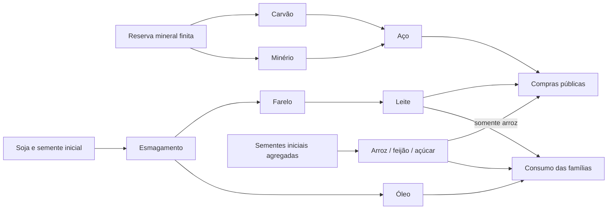

# Recursos, produção e padrão de expansão

**Base de trabalho de 27/10/2026.** Antes de criar conteúdo, usar o [catálogo gerado](RESOURCE-CATALOG.md): dez itens, nove receitas, cinco produtos de consumo familiar e sete programas públicos. Os dez itens têm origem produtiva e caminho até um consumo final; isso demonstra cobertura do catálogo. A viabilidade econômica e a recuperação após escassez continuam em avaliação.

Este documento define como analisar e admitir conteúdo. As fórmulas descrevem o motor atual quando indicado; critérios para conteúdo futuro são regras de desenvolvimento, não alterações retroativas da season. Valores são parâmetros de jogo, sem validação de cotações ou coeficientes industriais reais nesta etapa.

Para consultar os números por mecânica e os fluxos ainda incompletos, usar o [relatório consolidado](MECHANICS-REPORT.md), gerado com revisão/hash do snapshot e anexo de constantes. Ele distingue o que é criado na abertura do que é produzido durante o jogo.

## 1. Fontes de verdade

| Informação                                                                       | Fonte autoritativa                                                                 |
| -------------------------------------------------------------------------------- | ---------------------------------------------------------------------------------- |
| Identificador, nome, unidade comercial, massa e volume                           | `packages/simulation/src/model.ts`, `products` e `ProductId`                       |
| Receita, preço de abertura, consumo, salários, utilidades e capacidade por linha | `world.season.config`; templates em `model.ts`, `operations.ts` e `calibration.ts` |
| Consumo efetivamente executado                                                   | `channels.ts`, usado pelo motor e pelas políticas de lojas                         |
| Saldos, propriedade, estoque, reserva, equipe, equipamento, jobs e entregas      | Snapshot salvo do mundo; API transacional para jogar                               |
| Cobranças e custo fixo                                                           | `metrics.ts`; execução/arredondamento em `engine.ts`                               |
| Limites agregados de massa                                                       | `resource-policy.ts`; explicação para auditoria, sem gerar bens no motor           |
| Estoques e fornecedores da abertura                                              | `seed.ts` e `competition.ts`; não são reposição recorrente                         |
| Regras gerais, histórico e limitações                                            | [ECONOMY.md](ECONOMY.md), [auditoria de design](GAME-DESIGN-AUDIT.md) e decisões   |

O relatório informa hashes da configuração e do catálogo/canais, revisão e instante observado. A leitura do SQLite usa `readOnly`, sem importar `createStore`, migrar ou avançar o mundo. Receita do template e receita de uma season antiga podem divergir; comparar os relatórios antes de concluir que um parâmetro está ativo.

**Limite importante:** unidade/massa/volume dos produtos e listas de canais ainda vivem no código, fora da configuração congelada. Antes de acrescentar ou alterar esses dados no mundo salvo, versionar o esquema e planejar migração com backup. Não prometer isolamento completo de temporadas para esses campos.

## 2. O que existe e como obter

| Cadeia                       | Obtenção e transformação                                                                                                                                                   | Quem retira o material da economia                                       |
| ---------------------------- | -------------------------------------------------------------------------------------------------------------------------------------------------------------------------- | ------------------------------------------------------------------------ |
| Minério + carvão → aço       | Mina com reserva, equipe/equipamento, água e energia; indústria consome 12 t + 3 t e entrega 8 t                                                                           | Programas públicos de aço, com verba e entrega; famílias não compram aço |
| Soja → óleo + farelo → leite | Fazenda usa 1 t de soja como semente e entrega 26 t; indústria esmaga 1 t em 200 litros embalados + 760 kg de farelo; fazenda usa 50 kg de farelo para 300 litros de leite | Famílias compram óleo/leite; leite também atende programa público        |
| Arroz, feijão e açúcar       | Fazenda usa um pacote do próprio produto para iniciar cultivo/processamento agregado                                                                                       | Famílias; arroz também atende cozinhas públicas                          |

Para adquirir um item: produzir/extrair na própria unidade compatível, comprar estoque anunciado, negociar pedido com outro fornecedor ou transportar estoque próprio. Compra/transferência precisam de estoque livre, capacidade no destino, caixa/frete e veículos; novos despachos no servidor exigem rota rodoviária salva. Proposta ainda não reserva estoque. A mercadoria só aparece no destino ao chegar.

O catálogo mostra fornecedores, municípios/UF, quantidades livres e preços **da fonte e do instante indicados**. Transferência própria não exige anúncio nem gera receita. Estoque inaugural dos novos bots é finito e pago; parte do patrimônio/estoque dos participantes antigos é demonstração inicial, sem cadeia histórica de fabricação. Não usar esse estoque como evidência de reposição sustentável.

Nem todo recurso operacional é mercadoria:

| Recurso operacional | Como é obtido/pago hoje                                                   | Limite da representação                                               |
| ------------------- | ------------------------------------------------------------------------- | --------------------------------------------------------------------- |
| Imóvel e área       | Aquisição paga ao estado, titularidade única                              | Sem aluguel; lotes virtuais                                           |
| Equipamentos        | Instalação paga por linha                                                 | Sem indústria de equipamentos; instalação imediata                    |
| Trabalho            | Contratar, pagar folha/encargos e treinar                                 | Sem candidatos escassos, rescisão ou profissões individuais           |
| Energia e água      | Conexão/abastecimento do local; tarifas por consumo e estrutura           | Serviços pagos, não itens transportáveis; sem geradora/estação física |
| Reserva mineral     | Disponível no imóvel virtual, reduzida antes da extração                  | Finita, genérica por mina; não diferencia minério/carvão              |
| Frota e combustível | Compra de veículo; frete usa diesel/manutenção/motorista/pedágio estimado | Diesel não é comprado como item de estoque; sem refinaria             |
| Capital de giro     | Caixa existente, vendas ou crédito finito garantido                       | Crédito é passivo; não é receita nem recurso gratuito                 |

Embalagens, fertilizantes, ração complementar, rebanho, rejeitos comercializáveis, sementes próprias e bens de capital não existem como itens separados. Arroz/feijão/açúcar integram cultivo e beneficiamento. Açúcar como entrada de cana é uma convenção artificial do laboratório. Não descrever essas cadeias como agronomia completa.



## 3. Unidade comercial e fronteira física

Cada item tem uma única unidade de estoque/venda. Exemplos: soja e minério em toneladas; farelo em kg; arroz em pacote de 5 kg; óleo/leite em unidade de 1 litro. Quantidades dos comandos são inteiras; se precisarmos frações, escolher uma unidade menor e migrar explicitamente. Nunca trocar `t` por `kg` apenas na legenda.

Para quantidade `qᵢ`, massa unitária `mᵢ` em t e volume unitário `vᵢ` em m³:

```text
M = Σ qᵢ mᵢ                    V = Σ qᵢ vᵢ
Q por veículo = min(piso(capacidadeT / mᵢ), piso(capacidadeM3 / vᵢ))
Q da frota = soma dos limites por veículo livre
Q operação = min(Q frota, estoque livre, espaço comprometido disponível)
```

As capacidades são verificadas por veículo; não somar a frota antes de arredondar. Espaço comprometido inclui estoque físico, entregas pendentes e saídas de produção reservadas. Caixa/prazo/frete são restrições adicionais; não estão incluídos no máximo físico.

Por receita, exigir:

```text
massa de entradas físicas + origem externa declarada
  = massa de saídas físicas + residual declarado
```

Uma transformação deve explicar diferenças por insumo, coproduto ou perda; não adicionar uma origem genérica para fechar a conta. Extração precisa consumir reserva. Crescimento biológico pode usar uma fronteira agregada explicitamente limitada por tempo, área, equipe e custo. Água de serviço não é automaticamente água incorporada ao produto.

Hoje faltam destinos para 7 t/ciclo siderúrgico e 56 kg/ciclo de esmagamento. A declaração no auditor torna a lacuna visível; não implementa rejeitos/gases nem confirma rendimentos reais. Receitas novas precisam de justificativa própria; não copiar esses coeficientes.

## 4. Grafo de abastecimento e partida

Para cada item, responder: quem cria, qual entrada consome, onde existe a primeira unidade e quem consome definitivamente? Venda entre empresas movimenta estoque; consumo final o retira. Estoque inicial não substitui receita. Um ciclo `A → B → A` não é origem primária por si só.

O auditor calcula alcance a partir de estoque físico, cargas já reservadas e saídas de jobs existentes, sem antecipar sua disponibilidade no jogo. Também calcula o que poderia ser reposto sem estoque inaugural. Nenhuma lavoura atual parte do zero: soja/arroz/feijão/açúcar dependem da própria semente. Óleo, farelo e leite herdam a dependência da soja.

A automação agrícola protege a entrada do próximo lote conforme os ciclos configurados. Com automação desligada, a venda manual pode consumir a última semente. Não há importador/reposição infinita. Experimento necessário: extinguir sementes num cenário separado e definir recuperação paga/finita ou aceitar a extinção como regra; nenhuma política nova foi escolhida nesta entrega.

Para coprodutos, verificar o destino de **cada saída**. Atender ao óleo não significa que o farelo produzido junto será vendido.

## 5. Custos, capacidade e preço

Valores financeiros executados são inteiros em centavos; médias de custo podem ter fração de centavo. Usar o arredondamento do motor na contratação. Separar desembolso, custo do estoque, custo reconhecido e resultado.

```text
C material do lote = Σ arredondar(custo médio posto do insumo × q × ciclos)
C processamento = custo de receita × ciclos
C energia = arredondar(kWh × ciclos × tarifa)
C água = arredondar(m³ × ciclos × tarifa)
C lote = C material + C processamento + C energia + C água

linhas = min(piso(área / área por linha), piso(equipe / equipe por linha), equipamento)
duração do lote = duração por ciclo × teto(ciclos / linhas)
cadência automática = teto(duração do lote / intervalo econômico) × intervalo econômico
ciclos/dia em regime contínuo = ciclos por lote × dia / cadência automática
```

Há fila serial por unidade; lotes contratados consomem entradas e ocupam espaço antes de terminar. A automação espera não haver job pendente. O intervalo econômico é de duas horas virtuais. Assim, receita de uma hora em lotes automáticos unitários faz até 12 ciclos/dia nessa hipótese; não 24. Extração com lotes de dez tem outra produtividade. Início, fim de safra e caixa limitam resultados de janelas curtas.

Custos fixos diários incluem folha com encargos, manutenção e água/energia por funcionário. O motor divide cada componente em 12 cobranças arredondadas; a comparação reproduz esse detalhe. Na suspensão continuam 10% da manutenção. Pausa de produção mantém equipe/fixos.

Para saídas `bᵢ` e preços realizáveis `pᵢ`:

```text
Receita potencial por ciclo R = Σ bᵢ pᵢ
Contribuição MC = R − custo variável por ciclo
Resultado no período = receita realizada − CMV − custos fixos − outras despesas reconhecidas
Utilização de equilíbrio = fixos/dia / (MC × ciclos máximos/dia), se MC > 0
Preço para margem m num produto simples = custo completo unitário / (1 − m)
```

`m` é margem sobre venda, entre 0 e 1. Multiplicar custo por `1+m` calcula markup e dá outro resultado. Custo completo inclui insumos postos, processamento, utilidades, frete atribuível e fixos por volume **vendável**. CAPEX e principal de empréstimo são aplicações/passivos separados; incluir depreciação/juros no resultado só se houver regra implementada. Não presumir impostos inexistentes.

No coproduto, o motor distribui o custo total pela proporção do valor interno das saídas no início do job. Usa preço observado quando disponível; sem oferta usa abertura (×0,82 para unidade `un`). Arredonda alocações e atribui o resto à última saída, preservando a soma. O valor de abertura integral da tabela é uma hipótese comparável, diferente dessa alocação contábil. Crédito do coproduto não pode ser contado duas vezes nem tratado como caixa antes da venda.

Semente: separar saída bruta, retenção do próximo lote e excedente comercial. Valorar entrada e saída da semente no mesmo referencial permite comparar contribuição; não transforma retenção em venda.

Qualidade atual combina média das entradas, local e educação; a média usa quantidades comerciais, sem normalização de massa. As receitas atuais têm uma entrada ou entradas na mesma unidade. Antes de adicionar mistura de kg/t/embalagens, definir pesos de qualidade por receita e testar conversões; mudar a embalagem não deve melhorar qualidade por acidente.

Capital necessário considera aquisição + instalação + estoque inaugural + fretes + custos até a primeira venda + reserva operacional declarada. O auditor não calcula retorno garantido nem inclui esses desembolsos no resultado padronizado.

## 6. Oferta conjunta e demanda: diagnóstico inicial

O esmagamento gera 200 unidades de óleo e 760 kg de farelo. A cadeia de leite consome 50 kg e gera 300 unidades. Assim:

```text
farelo por óleo = 760 / 200 = 3,8 kg/un
leite equivalente por óleo = 3,8 / 50 × 300 = 22,8 un/un
demanda familiar relativa = 8 / 0,8 = 10 un de leite/un de óleo
fração excedente de farelo = 1 − 10 / 22,8 ≈ 56,14%
```

Hipótese: óleo/leite atendidos por essas cadeias e somente demanda familiar. Compras públicas de leite, estoques, oferta inicial e produção efetiva alteram o resultado observado. Este cálculo identifica pressão estrutural; não é um ajuste de preço recomendado.

Na leitura salva de **27/10/2026 às 03:48:51, America/Sao_Paulo**, revisão 5.132, havia **215.060 kg de farelo físico**, 214.955 kg anunciados e 905 kg de vendas de atacado registradas. Vendas de atacado não equivalem a consumo pela fazenda. Snapshot: `.runtime/resources/saved-world.json`; não é dado ao vivo. O relatório JSON também distingue estoque em trânsito e em produção. Não somar toneladas, kg e embalagens para medir estoque total.

Na comparação de uma linha/SP/equipe mínima/lotes automáticos unitários, cinco receitas têm resultado diário negativo mesmo sem frete e vendendo toda a saída: minério, arroz, feijão, açúcar e leite. Arroz: aproximadamente **−R$ 975,88/dia**; leite: **−R$ 533,80/dia**. Aço e soja têm grande folga nessa hipótese, mas precisam de compradores suficientes. Escala, preço de atacado efetivo, lotes, linhas e utilização mudam a comparação. Nenhum preço/rendimento foi alterado para encobrir esses problemas.

## 7. Matemática do balanceamento

Usar matriz de receitas, com `Aᵢᵣ` = entrada do item i por ciclo r e `Bᵢᵣ` = saída, sempre na unidade canônica. `xᵣ` representa ciclos no período; `dᵢ` o consumo final executável; `eᵢ` a extração/origem modelada quando separada das receitas. Não contar extração em `B` e `e` ao mesmo tempo.

```text
Δestoqueᵢ = Σᵣ (Bᵢᵣ − Aᵢᵣ) xᵣ + eᵢ − dᵢ − perdasᵢ
```

Para conservação física, incluir mercadoria em trânsito, entradas já consumidas pelos jobs e saídas contratadas conforme a fronteira do evento; transferências internas não criam oferta líquida. A equação agregada por período exige ajustar o trabalho em processo. Não exigir que massa por item seja conservada numa transformação; verificar os coeficientes e a fronteira material.

Testar se existe uma escala de produção que atende a demanda sem acumulação persistente de coprodutos, respeitando equipe, área, instalação, reserva, dinheiro e capacidade logística. Não é necessário adicionar um solver para as nove receitas; calcular primeiro o gargalo e as proporções. Guardar hipóteses para uma futura solução numérica reproduzível.

Demanda familiar potencial = população representada × consumo mensal / 30. Não é promessa de venda: o motor aplica calendário semanal, concorrência por preço/qualidade, arredondamento, estoque, capacidade e orçamento. A capacidade de atendimento da loja é compartilhada entre produtos. Demanda industrial exibida é potencial; não substituir por pedidos pagos. Programas públicos dependem da arrecadação e disputam orçamento com outras despesas.

No circuito monetário, soma de saldos deve permanecer constante; empréstimos e transferências não geram renda operacional. Conservar dinheiro é necessário, mas pode coexistir com concentração no tesouro, consumidores sem verba e cadeias insolventes.

## 8. Regra de admissão de item/receita

Preencher a [ficha obrigatória](RESOURCE-TEMPLATE.md) antes do código. Uma solicitação de geração por IA deve apontar a ficha e o critério de saída. Adicionar item exige uma decisão econômica identificável, não apenas uma variação de nome.

1. **Identidade e unidade:** ID estável, massa/volume, embalagem e escopo. Proveniência identificada como referência verificada, hipótese de jogo ou agregação. Código/consumidores compilam com o novo `ProductId`.
2. **Origem:** receita/extração, perfil de capacidade, primeira unidade/semente, reserva e recuperação. Sem fonte infinita implícita. Toda entrada deve ser alcançável no cenário de abertura.
3. **Transformação:** coeficientes positivos inteiros, duração/utilidades, fronteira de massa e destino dos coprodutos. Justificar rendimento e limites de escala. Não usar produto acabado como semente em conteúdo novo sem decisão explícita de abstração.
4. **Saída econômica:** consumidor produtivo ou canal final executado, orçamento pagador, preço/qualidade e frete viáveis. Cada coproduto precisa de destino e capacidade de absorção. Um campo `consumption` isolado não basta.
5. **Custo e concorrência:** contribuição/fixos/caixa de partida, sensibilidade, fornecedores independentes e recuperação. Metas de participação/margem são escolhidas por experimento; não inventar um percentual universal para aprovar conteúdo.
6. **Agentes e UX:** bot produtor/consumidor via mesmos comandos; compra, entrega, produção, anúncio, venda e erro recuperável. Nenhum botão que apenas notifica. Nova UI exige desktop/celular/teclado.
7. **Integridade e season:** falhas sem efeito parcial, reserva antes do evento, conclusão única, custo alocado e dinheiro conservado. Configuração congelada; nova season ou migração explícita com backup. Conferir também unidade/canais ainda externos à config.
8. **Evidência:** `npm run check`, auditoria estrutural, testes dos fluxos afetados e cenários comparáveis de 30/90 dias. Diagnósticos conhecidos precisam de responsável/próxima ação; não remover alerta para passar no check.

`resources:check` bloqueia erros estruturais e catálogo versionado divergente do código; não exige que os alertas legados sejam ignorados. `--strict` também falha diante dos alertas atuais; é deliberado. O auditor verifica referências, quantidades, capacidade, produtor bot, massa declarada, alcance de partida e caminho ao consumo. Ele não prova equilíbrio, ausência de arbitragem entre todas as receitas, absorção de mercado, viabilidade de cada lote/rota, disponibilidade geográfica contínua ou concorrência sob carga.

## 9. Próximos experimentos, nesta ordem

A auditoria matemática acrescentou uma precondição aos experimentos abaixo: corrigir a capacidade projetada/recuperação e a perda de frações na demanda, e explicitar a prioridade de serviço varejista; caso contrário, mudar coeficientes pode compensar erros de fórmula. Essas correções estão feitas e cobertas por `tests/formula-fixes.test.ts` sobre as receitas do catálogo.

| Prioridade | Experimento                                        | Medidas e saída                                                                                                                                                          |
| ---------- | -------------------------------------------------- | ------------------------------------------------------------------------------------------------------------------------------------------------------------------------ |
| 1          | Farelo/leite/óleo como um conjunto                 | Fluxos líquidos/dia, demanda familiar/pública, estoque por item, utilização e margens; escolher escala/coeficientes ou uso adicional somente com necessidade demonstrada |
| 2          | Uma fazenda iniciante por especialidade e uma mina | Primeira compra/produção/venda, menor lote/equipe/linha viável, capital até vender e lucro após frete/fixos; confrontar com o cenário de múltiplos ativos                |
| 3          | Sementes e reservas                                | Última semente indisponível, semente em trânsito/job e esgotamento mineral; decidir recuperação e vínculo por mineral sem criar fonte gratuita                           |
| 4          | Consumidor do aço e orçamento público              | Custo de cadeia, volume contratado/consumido e concentração; simular queda de arrecadação sem inventar compradores                                                       |
| 5          | Mesmas hipóteses em 30/90 dias                     | Baseline, demanda baixa e iniciante, múltiplas sementes; dinheiro, faltas por intervalo, estoque, caixa/atrasados, vendas e HHI por item/UF                              |

Alterar uma família de parâmetros por comparação controlada e registrar antes/depois. Separar aumento de produtividade, redução de fixos e aumento de demanda; misturá-los impede atribuir o resultado. Cobertura de estoque e concentração precisam de metas declaradas para o mercado/tempo estudado. O relatório diário atual de `balance:season` pode ocultar rupturas intradiárias; instrumentar os intervalos antes de afirmar oferta contínua.

## 10. Reproduzir

```powershell
npm run resources:catalog
npm run resources:check
npm run resources:audit -- --world=.runtime/world.sqlite
npm run resources:audit -- --strict
npm run balance:season -- --days=90 --scenario=baseline --seed=0
```

O primeiro comando regenera o catálogo de abertura versionado e grava JSON/Markdown em `.runtime/resources/opening.*`. A leitura do banco grava `saved-world.*` sem mexer na season; não pode sobrescrever o catálogo versionado. `--check` não escreve relatórios. `--strict` retorna falha enquanto houver qualquer alerta. Simulações de balanceamento criam mundos isolados com geografia estimada, sem abrir o banco principal.
